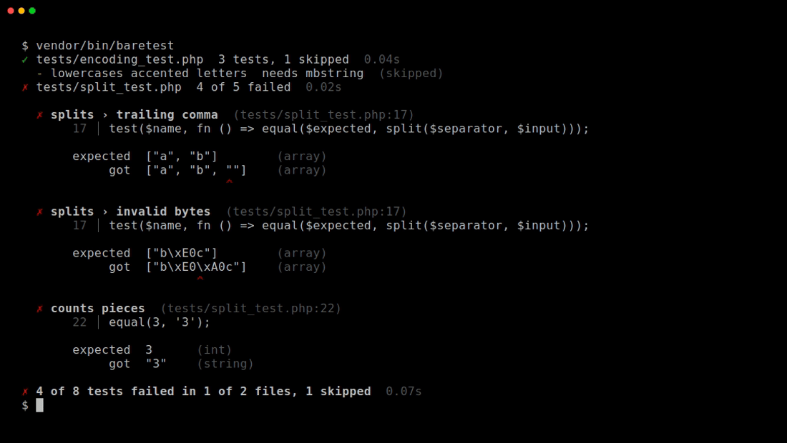

# baretest

A small test runner for PHP libraries. No dependencies, no extensions, PHP 7.4 to 8.6.

You can learn all of it in five minutes and read its source in an afternoon.



## Getting started

Install it:

```
composer require --dev fain182/baretest
```

Write a test file. Its name ends in `_test.php`, and it calls `test()` once for each test:

```php
<?php // tests/slug_test.php

use function Baretest\{test, equal, throws};

test('lowercases', function () {
    equal('hello-world', slug('Hello World'));
});

test('rejects empty input', function () {
    throws(InvalidArgumentException::class, fn () => slug(''));
});
```

Run it:

```
vendor/bin/baretest
```

## Why

PHPUnit and Pest do far more than baretest, and for an application they are the right choice. A library has different needs: it supports many PHP versions, it may have to run where few extensions are installed, and its tests should be as easy to read as its code.

| | baretest | PHPUnit 13 | Pest 5 |
|---|---|---|---|
| PHP versions | 7.4 and later | 8.4.1 and later | 8.4 and later |
| API to learn | 5 functions | 176 assertion methods | 16 functions and 131 expectations |
| Extensions required | none, runs on PHP built with `--disable-all` | dom, filter, json, libxml, mbstring, xmlwriter | those of PHPUnit, which it is built on |
| Test files isolated from each other | always, one process per file | opt-in, one process per test | not supported |
| Packages installed | 1 | 28 | 63 |
| Lines of PHP installed | under 1,000 | about 175,000 | about 333,000 |

<sub>Measured in November 2026 with `composer require` of the latest releases. baretest's size is checked in CI.</sub>

## Promises

What you can count on, and what every change to baretest is judged against.

1. **It runs wherever PHP runs.** No dependencies, no extensions, every supported PHP version. A feature that needs anything more is out.
2. **One way to do each thing.** No configuration and one flag, so a test means the same in every project.
3. **This README is all the documentation.** Read it once and you know everything. A feature that cannot be explained here in a few lines does not belong in baretest.
4. **You can read all of it.** Under 1,000 lines of source, so you can read what you depend on in an afternoon and trust it.
5. **Clear feedback comes first.** Lines spent on a clearer message or more precise feedback are worth it, even against promise 4.
6. **It will not change under you.** baretest is close to its final shape. A change must solve a real problem that cannot be solved in the test itself, and keep the promises above.

## Documentation

### API

Five functions in the `Baretest` namespace are the whole API:

| | |
|---|---|
| `test($name, $fn)` | runs `$fn` as a test; inside another test, as a subtest |
| `equal($expected, $actual)` | fails the test unless the two are identical (`===`) |
| `throws($class, $fn)` | fails the test unless `$fn` throws `$class`; returns the exception |
| `fail($message)` | fails the test |
| `skip($reason)` | stops the test and reports it as skipped, with `$reason` |

A failure stops the test it happens in. Any other test, and any other subtest, still runs. A failed subtest also fails the test that contains it.

A warning, notice or deprecation fails the test, unless it was silenced with `@`. So does an uncaught exception.

### Running

```
vendor/bin/baretest [PATH...]
```

- `PATH` is a file or a directory; directories are searched for `*_test.php`. Default: `tests/`.
- Each file runs in its own PHP process, with the same php.ini and `-d` settings as the runner. A fatal error, an `exit()` or a crash fails that file, and the other files still run.
- Anything a test file prints, with `echo` or `var_dump()`, is shown under the file.
- Output is coloured when it goes to a terminal, unless `NO_COLOR` is set.
- On GitHub Actions (`GITHUB_ACTIONS=true`) it also prints an `::error` line for each failure, which GitHub shows as an annotation on the code.
- On GitLab CI (`GITLAB_CI=true`) it also writes a JUnit XML report to `baretest-junit.xml` in the current directory: point `artifacts:reports:junit` at it, with `artifacts:when: always`.

Exit code: `0` all passed, `1` some failed, `2` the runner could not run (a missing path, a file that runs no tests).

### Table tests

A table is a `foreach`. Call `test()` for each row, so a failure says which row failed:

```php
test('splits', function () {
    $cases = [
        'commas'      => [',', 'a,b', ['a', 'b']],
        'no match'    => [',', 'abc', ['abc']],
        'empty input' => [',', '',    ['']],
    ];
    foreach ($cases as $name => [$separator, $input, $expected]) {
        test($name, fn () => equal($expected, explode($separator, $input)));
    }
});
```

### Skipping a test

A test that cannot run here calls `skip()` with the reason. The condition is PHP:

```php
test('lowercases accented letters', function () {
    if (!extension_loaded('mbstring')) {
        skip('needs mbstring');
    }
    equal('àb', mb_strtolower('ÀB'));
});
```

A skipped test does not fail the run, and it is always listed under its file with its reason. A test whose subtest failed stays failed even if it then calls `skip()`. Outside a test, `skip()` fails the file: to skip a whole file, put its tests inside one test.

### Expected warnings

Silence the call with `@` and read the warning with `error_get_last()`:

```php
test('rejects odd-length input', function () {
    $result = @hex2bin('abc');
    equal(false, $result);
    equal('hex2bin(): Hexadecimal input string must have an even length', error_get_last()['message']);
});
```

`error_get_last()` is cleared before each test and subtest. Within one test it keeps the last warning until another one replaces it, so call `error_clear_last()` between two checks.

### Everything else is PHP

Shared setup is a function. A repeated check is a function. A test that needs a temporary file creates it and deletes it in `finally`. baretest has no hooks for any of this, because PHP already does it.

## Not included, on purpose

- assertions beyond `equal` and `throws`: write the check in PHP and call `fail()`
- mocks, stubs and spies
- fixtures, setup/teardown hooks, dependency injection: use a function
- code coverage
- configuration files
- plugins, custom reporters, other output formats: a new CI platform can be supported, a new style cannot
- watch mode
- running files in parallel
- stopping at the first failure

A request for any of these will be closed with a link to this section.
